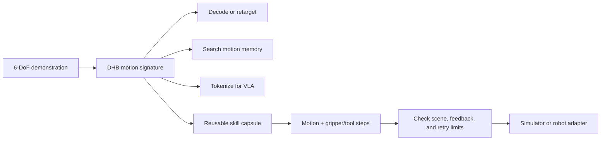

# DHB-XR

**Make robot motion portable across coordinate frames.**

DHB-XR turns a 6-DoF pose trajectory into a motion signature that stays stable
when the same motion is translated or rotated in the world. That common
representation can be decoded, adapted to new endpoints, searched in motion
memory, tokenized for VLA models, or packaged with object relations and
gripper/tool actions as a reusable skill.


*Generated by the runnable [frame-invariance example](examples_walkthrough.md).
The entire trajectory is moved by a 65° rotation and a translation; its DHB
channels agree to floating-point precision. This is a property demonstration,
not a task-success benchmark.*

## Why use it?

| Need | What DHB-XR provides |
| --- | --- |
| Reuse a motion in another scene frame | Trajectory-relative DHB-DR, DHB-QR, and speed-independent DHB-TI representations |
| Adapt a demonstration | Endpoint and relational retargeting with explicit solver and fallback policies |
| Find or learn recurring motion | Similarity search, invariant losses, and VLA-oriented tokenization |
| Preserve the meaning of a manipulation skill | Skill capsules containing raw motion, object-relative motion, sparse relations, gripper/tool actions, and provenance |
| Run multi-step behavior predictably | Typed motion sequences with explicit checks, feedback, bounded retries, reobservation, and stop conditions |
| Compare proposal methods fairly | Analytic, raw-pose, DHB, OCP, and learned candidates evaluated through the same external checks |



The NumPy core covers DHB-DR/DHB-QR encoding and decoding. Optional layers add
FATROP retargeting, fixed-horizon CusADi GPU decode, motion databases,
tokenizers, and manipulation programs. The final simulator or robot adapter
remains responsible for IK, collision checking, control, and physical safety.

## New in 0.5.0

- **Reusable skill capsules:** keep the original observation, motion in the
  object's initial frame, interaction events, actions, and source evidence
  together; DHB descriptors remain rebuildable indexes rather than the only
  copy of the motion.
- **Motion programs with explicit checks and recovery:** combine motion and
  gripper/tool steps with preconditions, measured feedback, bounded retries,
  and reobservation when scene information changes.
- **More credible comparisons:** evaluate analytic, DHB, optimization, learned,
  and strong raw-pose baselines using the same endpoint, relation, epoch, and
  payload-clearance checks.
- **Faster, lighter integration:** reuse a compiled relational FATROP solve
  surface across requests and import primitive contracts without eagerly
  loading plotting or solver stacks.

## Research Background

This library implements double-reflection (DHB-DR) and quaternion-relative
(DHB-QR) invariant representations for rigid-body motion trajectories on SE(3),
as described in the manuscript **"Double-Reflection DHB Invariant Representation
on SE(3)"**.

**Author:** Andy Park (andypark.purdue@gmail.com)

## Package capabilities

- **DHB-DR** (Double-Reflection): Euler-based invariants (4 values per component)
- **DHB-QR** (Quaternion-Relative): Quaternion-based invariants (5 values per component), no gimbal lock
- **DHB-TI** (Time-Invariant): Speed-independent representations via arc-length reparameterization
- **Trajectory generation**: FATROP-first boundary adaptation with explicit fallback policy
- **CusADi GPU decode**: Optional fixed-horizon decode libraries for `50`, `80`, `100`, `150`, and `200` samples
- **Tokenization**: VQ-VAE / RVQ for DHB-Token (VLA action representation)
- **Motion database**: Storage, similarity (L2, DTW), and retrieval
- **Primitive programs**: Analytic, DHB-memory, OCP, and learned motion proposals
  with portable gripper/tool actions, evidence, explicit checks and recovery,
  and revalidation when scene observations change
- **Imitation learning**: Invariant matching, SE(3) geodesic, and hybrid losses
- **Robust encoding**: Handles reversals, zero-motion segments, and frame alignment issues

## Quick start

```bash
pip install dhb_xr
# or with extras: pip install "dhb_xr[fatrop,cusadi,tokenization,database]"
```

From a source checkout, generate the overview above with one command:

```bash
pixi run overview-example
```

```python
from dhb_xr import encode_dhb_dr, decode_dhb_dr
from dhb_xr.core.types import DHBMethod, EncodingMethod
import numpy as np

# Create sample trajectory data
n = 50
positions = np.cumsum(np.random.randn(n, 3) * 0.01, axis=0)
quaternions = np.tile(np.array([1.0, 0.0, 0.0, 0.0]), (n, 1))  # identity orientation

# Encode trajectory to invariants
result = encode_dhb_dr(
    positions, quaternions,
    method=EncodingMethod.POSITION,
    use_default_initial_frames=True,
    dhb_method=DHBMethod.DOUBLE_REFLECTION
)

# Decode back to poses
decoded = decode_dhb_dr(
    result["linear_motion_invariants"],
    result["angular_motion_invariants"],
    result["initial_pose"],
    method=EncodingMethod.POSITION,
    dhb_method=DHBMethod.DOUBLE_REFLECTION,
    drop_padded=True
)

print(f"Original shape: {positions.shape}")
print(f"Decoded shape: {decoded['positions'].shape}")
```

## Examples

See [Examples](examples_walkthrough.md) for a walkthrough of the example scripts and how to run them.

## VLA Integration

DHB-XR integrates with Vision-Language-Action (VLA) benchmarks:

- **LIBERO**: Load trajectories, encode to DHB invariants, run in simulation
- **RoboCASA**: HDF5 dataset support with motion retrieval

See [VLA Integration Guide](integration/vla_integration.md) for setup and usage.

## API Reference

See the [primitive-program guide](primitive_programs.md) and [API
reference](api/index.md) for core encoding, decoding, optimization, database,
typed manipulation primitives, tokenization, losses, and visualization modules.

## License

MIT License.

**Copyright (c) 2026 Andy Park <andypark.purdue@gmail.com>**
