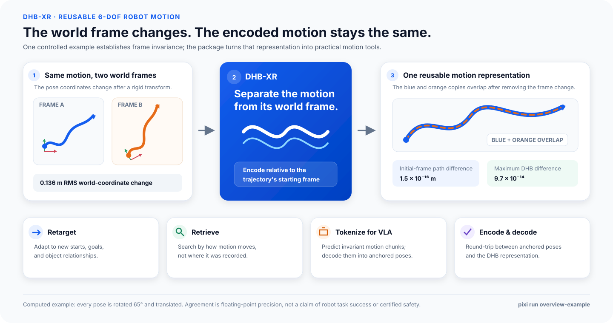
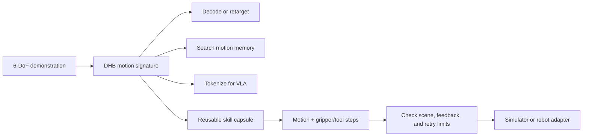

# DHB-XR

**Teach the motion once. Reuse it across coordinate frames.**

DHB-XR separates how a robot tool moves from where that motion was recorded.
Use the same 6-DoF representation to adapt trajectories, search motion memory,
compare motion generators, tokenize actions for VLA models, and build reusable
manipulation skills.

<picture>
  <source media="(max-width: 700px)" srcset="assets/dhb-xr-hero-mobile.svg">
  
</picture>

*The numbers in this package overview come from the runnable
[frame-invariance example](examples_walkthrough.md): the complete trajectory is
rotated 65° and translated, while corresponding DHB values agree to
floating-point precision. This demonstrates coordinate-frame invariance, not
robot task success.*

## Why use it?

| Need | What DHB-XR provides |
| --- | --- |
| Reuse a demonstrated motion | Translate or rotate the coordinate frame without changing the underlying motion representation |
| Adapt instead of starting over | Retarget a motion to new starts, goals, and object relationships |
| Find related motions | Search by motion shape rather than absolute world position |
| Keep a complete reusable skill | Store motion with object relationships, gripper/tool actions, where it came from, and how it has been tested |
| Run multi-step behavior reliably | Require fresh observations and measured feedback; retry or stop within explicit limits |
| Compare methods consistently | Check analytic, DHB, optimization, raw-pose, and learned proposals using the same criteria |



The NumPy core covers DHB-DR/DHB-QR encoding and decoding. Optional layers add
FATROP retargeting, fixed-horizon CusADi GPU decode, motion databases,
tokenizers, and manipulation programs. The final simulator or robot adapter
remains responsible for IK, collision checking, control, and physical safety.

## New in 0.5.0

- **Reusable skill capsules:** keep the original observation, motion in the
  object's initial frame, interaction events, actions, source dataset or file,
  usage license, and test history together. DHB descriptors remain rebuildable
  indexes rather than the only copy of the motion.
- **Motion programs with explicit checks and recovery:** combine motion and
  gripper/tool steps with preconditions, measured feedback, bounded retries,
  and reobservation when scene information changes.
- **More credible comparisons:** evaluate analytic, DHB, optimization, learned,
  and strong raw-pose baselines using the same endpoint, relation, epoch, and
  payload-clearance checks.
- **Faster, lighter integration:** reuse a compiled relational FATROP solve
  surface across requests and import primitive contracts without eagerly
  loading plotting or solver stacks.

## Research Background

This library implements double-reflection (DHB-DR) and quaternion-relative
(DHB-QR) invariant representations for rigid-body motion trajectories on SE(3),
as described in the manuscript **"Double-Reflection DHB Invariant Representation
on SE(3)"**.

**Author:** Andy Park (andypark.purdue@gmail.com)

## Package capabilities

- **DHB-DR** (Double-Reflection): Euler-based invariants (4 values per component)
- **DHB-QR** (Quaternion-Relative): Quaternion-based invariants (5 values per component), no gimbal lock
- **DHB-TI** (Time-Invariant): Speed-independent representations via arc-length reparameterization
- **Trajectory generation**: FATROP-first boundary adaptation with explicit fallback policy
- **CusADi GPU decode**: Optional fixed-horizon decode libraries for `50`, `80`, `100`, `150`, and `200` samples
- **Tokenization**: VQ-VAE / RVQ for DHB-Token (VLA action representation)
- **Motion database**: Storage, similarity (L2, DTW), and retrieval
- **Primitive programs**: Analytic, DHB-memory, OCP, and learned motion proposals
  with portable gripper/tool actions, evidence, explicit checks and recovery,
  and revalidation when scene observations change
- **Imitation learning**: Invariant matching, SE(3) geodesic, and hybrid losses
- **Robust encoding**: Handles reversals, zero-motion segments, and frame alignment issues

## Quick start

```bash
pip install dhb_xr
# or with extras: pip install "dhb_xr[fatrop,cusadi,tokenization,database]"
```

Reproduce the measurements and generate the technical validation figure with
one command:

```bash
pixi run overview-example
```

```python
from dhb_xr import encode_dhb_dr, decode_dhb_dr
from dhb_xr.core.types import DHBMethod, EncodingMethod
import numpy as np

# Create sample trajectory data
n = 50
positions = np.cumsum(np.random.randn(n, 3) * 0.01, axis=0)
quaternions = np.tile(np.array([1.0, 0.0, 0.0, 0.0]), (n, 1))  # identity orientation

# Encode trajectory to invariants
result = encode_dhb_dr(
    positions, quaternions,
    method=EncodingMethod.POSITION,
    use_default_initial_frames=True,
    dhb_method=DHBMethod.DOUBLE_REFLECTION
)

# Decode back to poses
decoded = decode_dhb_dr(
    result["linear_motion_invariants"],
    result["angular_motion_invariants"],
    result["initial_pose"],
    method=EncodingMethod.POSITION,
    dhb_method=DHBMethod.DOUBLE_REFLECTION,
    drop_padded=True
)

print(f"Original shape: {positions.shape}")
print(f"Decoded shape: {decoded['positions'].shape}")
```

## Examples

See [Examples](examples_walkthrough.md) for a walkthrough of the example scripts and how to run them.

## VLA Integration

**Relative actions are the right starting point. DHB-XR turns them into reusable
motion.**

Representing a future pose chunk relative to its initial end-effector frame is
already a strong VLA design: a shared rotation or translation of the world does
not change that relative chunk. This direction appears in the
[UMI policy interface](https://arxiv.org/abs/2402.10329), a
[NeurIPS 2025 study of relative trajectory actions](https://papers.nips.cc/paper_files/paper/2025/hash/8756b018fb31576a8cdbb8bcb14ec7be-Abstract-Conference.html),
and [Qwen-VLA](https://arxiv.org/abs/2605.30280).

| Representation layer | What it provides |
| --- | --- |
| World-frame pose chunk | Direct targets, but the numbers change when the world frame changes |
| Initial-frame relative chunk | Removes the global starting pose and keeps the chunk stable under a shared SE(3) transform |
| **DHB-XR motion layer** | Keeps that frame independence while adding a geometric motion signature that can be decoded, retargeted, retrieved, time-normalized, or tokenized |

This is a broader systems interface, not a claim that DHB-XR is *more
frame-invariant* than a correctly constructed relative-pose chunk. Its proposed
VLA advantage is that the predicted motion can flow through the same tested
tools for adaptation, memory, action-token streaming, and execution checks.

DHB-XR integrates with Vision-Language-Action benchmarks:

- **LIBERO**: Load trajectories, encode to DHB invariants, run in simulation
- **RoboCASA**: HDF5 dataset support with motion retrieval

See [VLA Integration Guide](integration/vla_integration.md) for setup and usage.

## API Reference

See the [primitive-program guide](primitive_programs.md) and [API
reference](api/index.md) for core encoding, decoding, optimization, database,
typed manipulation primitives, tokenization, losses, and visualization modules.

## License

MIT License.

**Copyright (c) 2026 Andy Park <andypark.purdue@gmail.com>**
