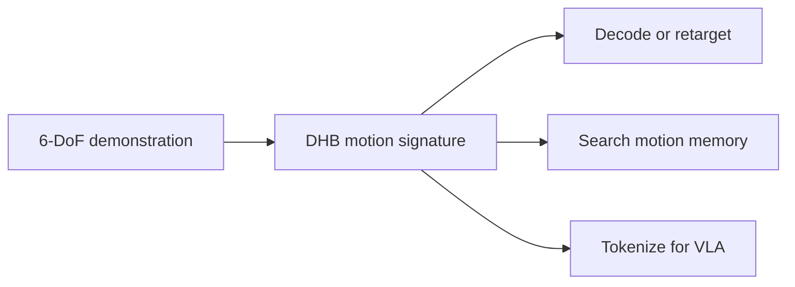

# DHB-XR

**Teach the motion once. Reuse it across coordinate frames.**

DHB-XR separates how a robot tool moves from where that motion was recorded.
Use the same 6-DoF representation to encode and reconstruct trajectories,
adapt endpoints, search motion data, and prepare frame-independent inputs for
action tokenization.

<picture>
  <source media="(max-width: 700px)" srcset="assets/dhb-xr-hero-mobile.svg">
  
</picture>

*The numbers in this package overview come from the runnable
[frame-invariance example](examples_walkthrough.md): the complete trajectory is
rotated 65° and translated, while corresponding DHB values agree to
floating-point precision. This demonstrates coordinate-frame invariance, not
robot task success.*

## Why use it?

| Need | What DHB-XR provides |
| --- | --- |
| Reuse a demonstrated motion | Translate or rotate the coordinate frame without changing the underlying motion representation |
| Adapt instead of starting over | Retarget a motion to new starts, goals, and object relationships |
| Find related motions | Search by motion shape rather than absolute world position |
| Reconstruct a trajectory | Decode the representation from a declared starting pose |
| Reduce timing sensitivity | Reparameterize motion by geometric progress with DHB-TI |
| Prepare VLA action inputs | Feed invariant sequences to tested continuous or discrete token interfaces |



The NumPy core covers DHB-DR/DHB-QR encoding and decoding. Optional layers add
FATROP retargeting, fixed-horizon CusADi GPU decode, motion databases,
and tokenizers. The final simulator or robot adapter remains responsible for
IK, collision checking, control, and physical safety.

## Validated in 0.5.0

- **Reproducible frame-invariance check:** one controlled fixture moves every
  pose by the same 65° rotation and translation. Start-relative positions agree
  within `1.5e-16 m`, and all DHB channels remain below the declared `1e-12`
  numerical tolerance.
- **Clear relative-action baseline:** the technical figure now shows that a
  correctly constructed initial-frame pose chunk is already frame-invariant;
  DHB-XR does not claim otherwise.
- **Release automation:** merge-triggered publishing validates synchronized
  version metadata, builds retained distributions, uses trusted PyPI
  publishing, and creates the GitHub release only after publication succeeds.

Experimental primitive programs, skill capsules, and representation-isolation
benchmarks are kept in [development notes](development_notes.md). Their software
tests do not establish simulator or robot task performance, so they are not
release highlights.

## Research Background

This library implements double-reflection (DHB-DR) and quaternion-relative
(DHB-QR) invariant representations for rigid-body motion trajectories on SE(3),
as described in the manuscript **"Double-Reflection DHB Invariant Representation
on SE(3)"**.

**Author:** Andy Park (andypark.purdue@gmail.com)

## Package capabilities

- **DHB-DR** (Double-Reflection): Euler-based invariants (4 values per component)
- **DHB-QR** (Quaternion-Relative): Quaternion-based invariants (5 values per component), no gimbal lock
- **DHB-TI** (Time-Invariant): Speed-independent representations via arc-length reparameterization
- **Trajectory generation**: FATROP-first boundary adaptation with explicit fallback policy
- **CusADi GPU decode**: Optional fixed-horizon decode libraries for `50`, `80`, `100`, `150`, and `200` samples
- **Tokenization**: VQ-VAE / RVQ for DHB-Token (VLA action representation)
- **Motion database**: Storage, similarity (L2, DTW), and retrieval
- **Imitation learning**: Invariant matching, SE(3) geodesic, and hybrid losses
- **Robust encoding**: Handles reversals, zero-motion segments, and frame alignment issues

## Quick start

```bash
pip install dhb_xr
# or with extras: pip install "dhb_xr[fatrop,cusadi,tokenization,database]"
```

Reproduce the measurements and generate the technical validation figure with
one command:

```bash
pixi run overview-example
```

```python
from dhb_xr import encode_dhb_dr, decode_dhb_dr
from dhb_xr.core.types import DHBMethod, EncodingMethod
import numpy as np

# Create sample trajectory data
n = 50
positions = np.cumsum(np.random.randn(n, 3) * 0.01, axis=0)
quaternions = np.tile(np.array([1.0, 0.0, 0.0, 0.0]), (n, 1))  # identity orientation

# Encode trajectory to invariants
result = encode_dhb_dr(
    positions, quaternions,
    method=EncodingMethod.POSITION,
    use_default_initial_frames=True,
    dhb_method=DHBMethod.DOUBLE_REFLECTION
)

# Decode back to poses
decoded = decode_dhb_dr(
    result["linear_motion_invariants"],
    result["angular_motion_invariants"],
    result["initial_pose"],
    method=EncodingMethod.POSITION,
    dhb_method=DHBMethod.DOUBLE_REFLECTION,
    drop_padded=True
)

print(f"Original shape: {positions.shape}")
print(f"Decoded shape: {decoded['positions'].shape}")
```

## Examples

See [Examples](examples_walkthrough.md) for a walkthrough of the example scripts and how to run them.

## VLA Integration

**Relative actions are the right starting point. DHB-XR turns them into reusable
motion.**

Representing a future pose chunk relative to its initial end-effector frame is
already a strong VLA design: a shared rotation or translation of the world does
not change that relative chunk. This direction appears in the
[UMI policy interface](https://arxiv.org/abs/2402.10329), a
[NeurIPS 2025 study of relative trajectory actions](https://papers.nips.cc/paper_files/paper/2025/hash/8756b018fb31576a8cdbb8bcb14ec7be-Abstract-Conference.html),
and [Qwen-VLA](https://arxiv.org/abs/2605.30280).

| Representation layer | What it provides |
| --- | --- |
| World-frame pose chunk | Direct targets, but the numbers change when the world frame changes |
| Initial-frame relative chunk | Removes the global starting pose and keeps the chunk stable under a shared SE(3) transform |
| **DHB-XR motion layer** | Keeps that frame independence while adding a geometric motion signature that can be decoded, retargeted, retrieved, time-normalized, or tokenized |

The release validates the representation-level frame stability shown above and
the package's software interfaces. It does not yet establish that a DHB action
head improves learned-policy success or data efficiency over a relative-pose
action head; that hypothesis remains in the
[development notes](development_notes.md#vla-evaluation-hypothesis).

DHB-XR integrates with Vision-Language-Action benchmarks:

- **LIBERO**: Load trajectories, encode to DHB invariants, run in simulation
- **RoboCASA**: HDF5 dataset support with motion retrieval

See [VLA Integration Guide](integration/vla_integration.md) for setup and usage.

## API Reference

See the [API reference](api/index.md) for validated core encoding, decoding,
optimization, database, tokenization, losses, and visualization modules.

## License

MIT License.

**Copyright (c) 2026 Andy Park <andypark.purdue@gmail.com>**
