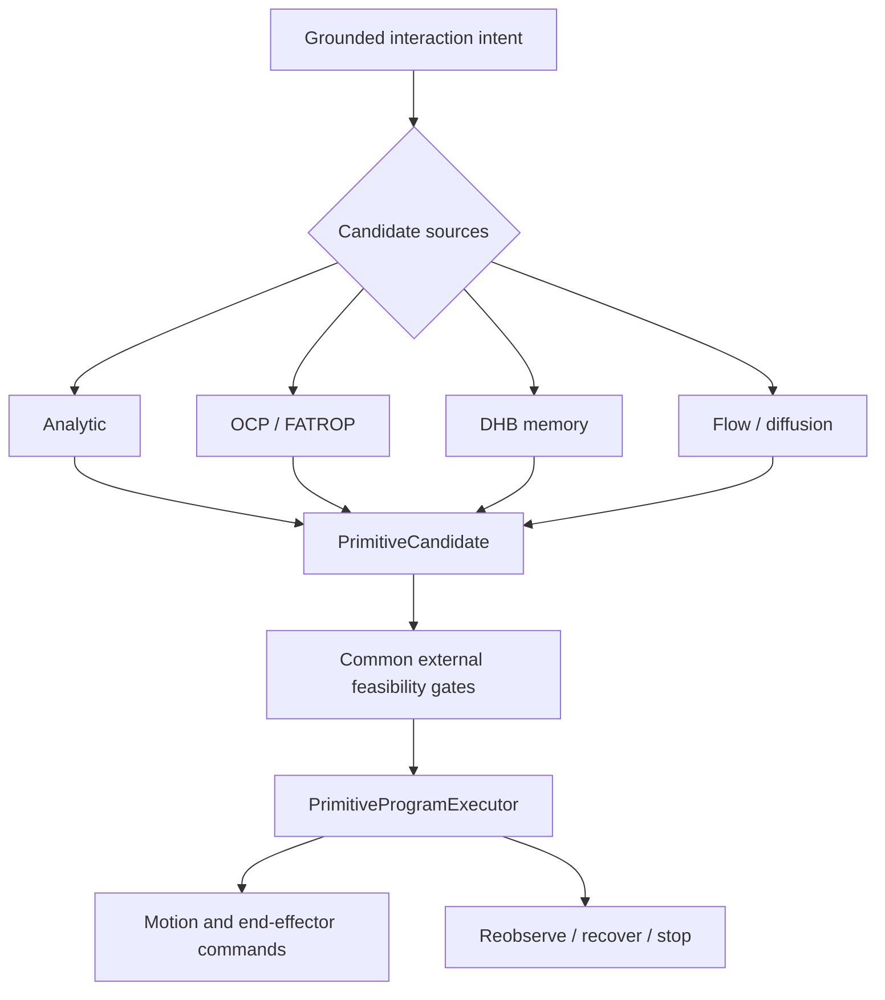

# Primitive programs

!!! warning "Development preview"

    This subsystem has software and isolated component tests, but it has not
    been validated as a simulator or robot manipulation system. It is documented
    separately from the validated release highlights, and its APIs may change.

DHB-XR primitive programs bind reusable SE(3) geometry to official
end-effector actions, evidence, observation epochs, and explicit execution
checks. The module is intentionally dependency-light: analytic generation and
contract validation do not require CasADi, CUDA, FAISS, a simulator, or a robot
driver.

!!! warning "Evidence boundary"

    The package validates contracts and control flow. A `planned` primitive is
    not demonstrated or physically safe. Simulation and real-robot promotion
    require separate passing verification records.

## Architecture



DHB invariants continue to represent geometry. Gripper/contact semantics are
part of the primitive package and retrieval signature, but they are not mixed
into the invariant vector.

## Analytic motion portfolio

The built-in analytic generators cover:

- synchronized translational and rotational minimum jerk;
- affordance-normal approach or retreat;
- circular arcs;
- screw motion with coupled axial translation; and
- shared-waypoint, piecewise minimum-jerk paths.

```python
import numpy as np
from dhb_xr.primitives import minimum_jerk_path

path = minimum_jerk_path(
    start_position=np.array([0.4, 0.0, 0.3]),
    start_quaternion_wxyz=np.array([1.0, 0.0, 0.0, 0.0]),
    goal_position=np.array([0.55, 0.0, 0.12]),
    goal_quaternion_wxyz=np.array([1.0, 0.0, 0.0, 0.0]),
    samples=50,
    duration_s=2.0,
)
```

Analytic paths are generated directly. Encoding one into DHB can be useful for
comparison, composition, or an ablation, but retrieval should not replace a
cheaper exact generator.

## First-class end-effector actions

`EndEffectorCommand` supports portable semantic commands including `open`,
`release`, `preshape`, `close_to_width`, `close_until_contact`, `hold`,
`maintain`, and suction state. A robot-specific adapter remains responsible for
mapping these semantics to actuator commands and measurements.

```python
from dhb_xr.primitives import (
    ActionTiming,
    EndEffectorCommand,
    EndEffectorCommandType,
    ScheduledEndEffectorAction,
)

grasp = ScheduledEndEffectorAction(
    EndEffectorCommand(
        EndEffectorCommandType.CLOSE_UNTIL_CONTACT,
        max_force_n=30.0,
        timeout_s=1.0,
    ),
    timing=ActionTiming.BEFORE_MOTION,
)
```

Actions can run before motion, during a declared phase, after motion, or after
an observation event. Completion guards should use measured aperture, force,
contact, pressure, or object state rather than a fixed delay.

## Execution checks and recovery

`PrimitiveProgram` is an immutable graph. `PrimitiveProgramExecutor` consumes
timestamped `ExecutionObservation` and `PrimitiveFeedback` values and emits
typed motion, end-effector, stop, and reobservation commands.

It fails closed when:

- a candidate observation epoch is stale;
- a start or completion condition is not satisfied;
- a timeout or retry budget is exhausted;
- more than one transition is enabled; or
- a transition declares that downstream geometry must be regrounded.

The executor coordinates commands; it does not perform IK or certify collision
safety. EmbodiK or another embodiment layer must approve and realize motion
before execution.

Run the deterministic architecture example:

```bash
pixi run primitive-example
```

The example executes approach, measured preshape, grasp-until-contact, lift and
hold, supported release, and retreat. Its observations are synthetic and its
evidence is explicitly `planned`.

### Integrated external simulation pilot

The sister `diffusion-flow-sim-lab` repository also exercises this exact
executor through its Panda bottle-sort stack:

```bash
./scripts/run_registered_experiment.sh dhb_primitive_program_sim
```

Its frozen 2026-08-08 run completed 20/20 randomized nominal MuJoCo episodes,
recovered from one injected close-command rejection with exactly one retry, and
stopped/revalidated/resumed once after a deliberately stale transfer epoch.
The result bundle is
`results/architecture/dhb_primitive_program_sim/20260808T210441Z/results.json`
in that repository, with SHA-256
`17501bb005bcbb0b4c0ca082b448bae0c45e8b56053ffda39dfebfba3169b97d`.

This validates integrated contract execution, not a unique DHB motion benefit.
The pilot used privileged MuJoCo state, a fixed semantic plan, planned
minimum-jerk geometry adapted through DHB-XR, a synthetic actuator fault, and
an unchanged scene for stale-epoch revalidation. It did not compare motion
sources, estimated perception, or real hardware.

## Candidate-source adapters

All proposal sources implement the same `propose(PrimitiveRequest)` boundary:

- `AnalyticPrimitiveSource` generates a configured analytic family.
- `DHBRetargetSource` adapts a stored full-SE(3) reference through the existing
  `generate_trajectory` API and records the selected backend.
- `BackendPrimitiveSource` wraps an OCP, flow, diffusion, or custom callable
  and preserves multiple candidate ranks.

Every returned candidate retains its reference frames, observation epoch,
gripper actions, guards, evidence, and backend metadata. A source produces an
unapproved proposal; it cannot approve safety or task success.

## Demonstration segmentation

`exact_gripper_run_control_indices` reproduces a sample-exact scalar
change-point baseline. `hysteretic_gripper_control_indices` avoids creating a segment at
every value in a continuous gripper ramp. `propose_primitive_boundaries` can
also add contact transitions and object-motion onset.

`split_motion_at_indices` treats each transition waypoint as a shared endpoint
of its preceding and following segments. `stitch_motion_paths` refuses to join
pieces whose shared position or orientation disagrees.

These functions propose boundaries; they do not prove semantic correctness.
Imported segments still require calibration checks, relational grounding,
replay, and physical verification.

`DemonstrationTrace` is the canonical pilot ingestion contract. It retains the
motion, gripper stream, optional contact/object signals, dataset and license,
source URI, and action convention. `mine_demonstration_segments` returns
`MinedPrimitiveSegment` proposals. Converting one with `segment_to_candidate`
requires an explicit semantic label; the importer deliberately does not invent
an executable skill name from change points alone.

## Matched portfolio gates

`PrimitivePortfolio` runs every declared source through the same ordered gate
set. The included gates check observation epoch, Cartesian endpoints,
intermediate relational poses, dense
sampled-TCP sphere clearance, and an oriented payload box against fixture
axis-aligned boxes at interpolated poses. The payload gate covers the carried
volume and orientation, but it remains a dense discrete geometric check: it
does not certify continuous time, robot links, or contact dynamics.

Run the 20-trial component benchmark:

```bash
pixi run primitive-benchmark \
  --output artifacts/primitive-portfolio.json \
  --figure artifacts/primitive-portfolio.svg
```

The deterministic setup places a sphere on the direct route. Minimum jerk is a
negative control and is rejected; a shared-waypoint detour is accepted. This
checks common proposal/gate accounting, not manipulation-task success.
The JSON report is authoritative; the SVG visualizes representative geometry,
all-gate acceptance, and generation latency from the same report.

The exploratory retarget-isolation screen adds a strong non-DHB reuse control:
`EndpointCorrectedReferenceSource` applies smooth Cartesian and quaternion
endpoint residuals to the same raw SE(3) reference. It then compares that
control, direct minimum jerk, and DHB retargeting on an asymmetric payload
passing through wide-short and narrow-tall apertures:

```bash
pixi run -e cuda retarget-isolation --trials 20 \
  --output artifacts/retarget-isolation.json \
  --figure artifacts/retarget-isolation.svg
```

The reference is oracle-selected and synthetic. This screen is designed to
reject an uninteresting DHB claim early; it is not robot-feasibility or task
success evidence. A confirmatory experiment must be frozen separately and add
task-frame rigid replay, raw-Cartesian constrained OCP, fresh planning, EmbodiK,
and physical simulation under matched information and compute accounting.

### Relational-anchor representation screen

`RelationalPoseAnchor` makes intermediate scene relations part of the grounded
request rather than hiding them in source-specific metadata. The persistent
FATROP surface builds its OCP graph once and accepts new endpoints and anchor
targets as parameters. It also compiles that parameterized problem to a
reusable CasADi function: graph construction remains a startup cost, while
steady-state request timing covers only invariant encoding and the compiled
solve. Its `dhb` and `cartesian` variants share graph
structure, dynamics, anchor penalties, initialization, solver, and gates; only
the representation regularizer changes.

The strongest raw control is `RelationalAnchorReferenceSource`, which applies
piecewise minimum-jerk SE(3) residuals directly to the same reference. It must
be included in any distinctive-DHB comparison; beating endpoint-only replay or
direct minimum jerk is insufficient.

```bash
pixi run -e fatrop relational-retarget \
  --hard-trials 60 --easy-trials 20 \
  --output artifacts/relational-retarget.json \
  --figure artifacts/relational-retarget.svg
```

The current FATROP graph optimizes the linear DHB state. Intermediate
orientation anchors use the same deterministic quaternion correction for both
regularizers, so this benchmark can support only a linear-representation
claim. Payload geometry remains a discrete proposal gate. Robot links,
continuous collision, perception, retrieval, and physical task success belong
to downstream validation. Report startup/build latency separately from
steady-state generation latency; combining them obscures the deployment
tradeoff.

## Evidence-preserving memory

The package keeps each skill's source and test history—often called
**provenance**. Concretely, that means where the motion came from, which version
or episode supplied it, the action convention and license, and which simulation
or robot checks it has passed or failed.

`PrimitiveMemory` stores the raw typed candidate, DHB-DR geometry, interaction
signature, source convention, license, source details, and complete test
history. Retrieval filters interaction semantics before ranking geometric
similarity.

```python
from dhb_xr.primitives import (
    EvidenceLevel,
    PrimitiveMemory,
    VerificationOutcome,
    VerificationRecord,
)

memory = PrimitiveMemory()
record = memory.add(candidate, source_uri="dataset://episode/42")

memory.record_verification(
    record.entry_id,
    VerificationRecord(
        outcome=VerificationOutcome.PASSED,
        level=EvidenceLevel.SIM_VERIFIED,
        protocol_id="mujoco-pick-place-v1",
        artifact_hash="sha256:...",
        metadata={"episodes": 20, "successes": 20},
    ),
)
```

A failed verification is retained but does not promote evidence. Successful
execution should only be added as a distinct memory item when it fills a
measured coverage gap or improves evidence.

## Recommended validation order

1. Compare wrist-only, sample-synchronous scalar gripper, sample-exact
   change-point segmentation, and event-driven primitive programs.
2. Hold tasks, seeds, observation information, controller, feasibility gates,
   and compute accounting fixed.
3. Compare direct minimum jerk, analytic portfolio, rigid replay, DHB retarget,
   learned flow, and a separately reported oracle portfolio.
4. Measure task outcome, grasp acquisition, retention, forbidden contact,
   latency, retries, stale cancellations, and unique DHB coverage.
5. Keep `planned`, `sim_verified`, and `real_verified` result columns separate.

The decisive DHB claim is bounded: retained full-SE(3) geometry should provide
unique value on declared nontrivial transfer cases. Open-space motion where
minimum jerk is sufficient remains a necessary negative control.

See [release validation](release_validation.md) for the value assessment,
claim-to-benchmark matrix, artifact format, and release gates.
