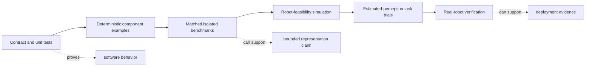

# Experimental feature validation notes

!!! warning "Not release-facing evidence"

    This page tracks development-preview primitives and representation
    experiments. Its unit tests and isolated fixtures do not establish simulator
    or robot task performance and are intentionally excluded from the validated
    release highlights.

This page separates software correctness, component behavior, representation
value, and physical-task evidence. Passing a lower layer is required but does
not imply a higher one.

## What the branch adds

| Change | User/research value | Evidence now | Release implication |
| --- | --- | --- | --- |
| Typed primitive contracts and executor with explicit checks and recovery | Makes geometry, gripper semantics, evidence, epochs, and recovery explicit and serializable. | Unit tests plus deterministic end-to-end state-machine example. | Meaningful reusable infrastructure; downstream robot adapters remain responsible for command realization and safety. |
| Analytic sources and common portfolio gates | Gives cheap baselines and forces matched evaluation across proposal sources. | Deterministic direct-path negative control and detour positive control. | Strong experimental hygiene; not evidence that DHB is better. |
| Demonstration ingestion, segmentation, and memory | Keeps source dataset, license, action convention, and test history without silently treating every change point as a named skill. | Contract, round-trip, retrieval, and segmentation tests. | Useful foundation, but dataset-scale retrieval quality and curation cost are still unmeasured. |
| Raw-SE(3) endpoint and relational controls | Prevents comparisons against weak replay baselines. | Included in isolated synthetic screens. | Increases scientific credibility even when the control wins; should remain in future evaluations. |
| Persistent matched relational FATROP | Reuses one parameterized solve surface and compares DHB versus Cartesian regularization under matched structure. | Solver tests and exploratory oracle-anchor benchmark. | Potential runtime and representation value; current orientation policy limits the scientific claim to linear path geometry. |
| VLA relative-action positioning | Treats initial-frame relative SE(3) chunks as a strong invariant baseline and states what DHB-XR adds around them. | Algebraic invariance argument, runnable frame-transform fixture, and package capability matrix. | Supports a systems-integration claim only; a matched learned-policy study is still required before claiming better VLA success or data efficiency. |
| Lazy package exports | Keeps contract/executor imports free of plotting and solver stacks. | Import-isolation tests. | Clear integration value for lightweight consumers and deployment processes. |
| Dense oriented-payload gate | Screens orientation-dependent payload/fixture interference. | Scalar/vector parity and benchmark coverage. | Better than TCP-only clearance, but still excludes robot links, swept continuous time, and dynamics. |

These items remain development previews until the evidence required by their
claim level is available. Package metadata validation is independent of their
promotion status.

## Evidence ladder



## Reproducible local checks

Run the dependency-light layer first:

```bash
pixi run pytest -q
pixi run mkdocs build --strict
pixi run primitive-example
pixi run primitive-benchmark \
  --output artifacts/primitive-portfolio.json \
  --figure artifacts/primitive-portfolio.svg
```

The JSON is the auditable result; the SVG is a review aid showing representative
path geometry, all-gate acceptance, and request latency. Regenerate a figure
from a saved report without rerunning a solver:

```bash
PYTHONPATH=src pixi run python examples/plot_primitive_benchmark.py \
  artifacts/primitive-portfolio.json \
  --output artifacts/primitive-portfolio.png
```

Run the optional solver layers in their declared environments:

```bash
pixi run -e cuda retarget-isolation \
  --trials 20 \
  --output artifacts/retarget-isolation.json \
  --figure artifacts/retarget-isolation.svg

pixi run -e fatrop relational-retarget \
  --hard-trials 60 \
  --easy-trials 20 \
  --output artifacts/relational-retarget.json \
  --figure artifacts/relational-retarget.svg
```

Record the Git commit, dependency lock hash, OS/CPU/GPU, solver, warm-up policy,
seed, sample horizon, and raw JSON alongside published numbers. Treat build
latency separately from steady-state request latency.

## Claim-to-benchmark matrix

| Claim | Required comparison | Primary metric | Necessary control |
| --- | --- | --- | --- |
| Contracts are integration-ready | Serialize/restore and execute the same program | Exact round trip and terminal trace | Dependency-light import process |
| Portfolio accounting is fair | Every source receives the same request and gates | Per-source errors, acceptance, gate reasons, latency | Direct minimum-jerk negative control |
| DHB reuse adds geometric value | Matched information and compute across reuse methods | Paired all-gate acceptance with confidence interval | Endpoint-corrected and relational raw-SE(3) replay |
| Persistence improves deployment latency | Build once, solve repeated requests | Build time and warm steady-state p50/p95 separately | Rebuild-per-request solver |
| Motion is robot-feasible | Same embodiment/controller and collision model | IK success, link clearance, constraint violations | Fresh planner and raw-Cartesian constrained OCP |
| Motion improves manipulation | Frozen tasks and estimated observations | Task success, grasp retention, forbidden contact, retries | Rigid replay, analytic portfolio, learned source |

## Release gates

- All tests and strict docs build pass in a clean checkout.
- Wheel and sdist install into clean environments; base import does not pull
  optional solver/plotting stacks.
- Every public primitive symbol is listed in the API reference.
- Example commands write versioned JSON with explicit maturity and claim
  boundaries; visualizations are derived from those reports.
- Confirmatory results use a protocol frozen before trials and do not reuse
  exploratory seeds for tuning.
- `planned`, `sim_verified`, and `real_verified` evidence remain separate in
  reports, memory, docs, and release claims.
