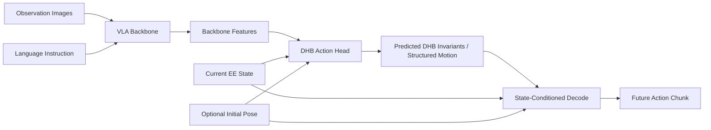
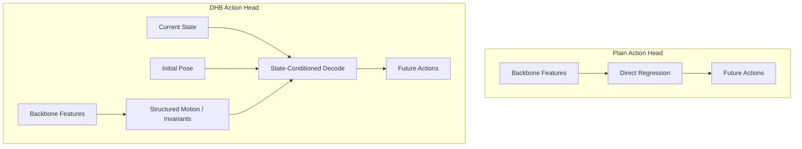
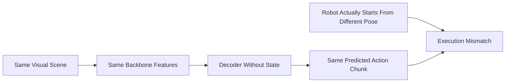
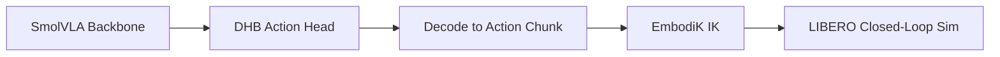

# DHB Action Head: Internal Note

## Purpose

This note explains what the DHB action head is, how it is supposed to work in the current codebase, what was fixed in the recent integration work, and what the current results do and do not show.

The target audience is an internal collaborator who wants a practical mental model of the DHB action head before turning it into slides, figures, or manuscript material.

## One-Sentence Summary

The DHB action head is a state-conditioned, geometry-aware action decoder that predicts a structured motion representation and then decodes executable action chunks relative to the robot's current pose, instead of treating action prediction as plain open-loop regression from backbone features alone.

## Why We Built It

A plain action head often learns to map observation-language features directly to future actions. That can work in-distribution, but it is brittle when the actual robot state shifts even slightly from the nominal demonstration state.

The DHB action head is intended to improve this by:
- using a structured geometric representation instead of only direct action regression
- conditioning decoding on the current robot state
- making action generation more consistent under spatial perturbation
- reducing the chance that a visually plausible feature vector decodes to the wrong absolute motion

In practical terms, the design goal is to help the policy preserve the intended motion geometry while remaining aware of where the arm actually is right now.

## Core Intuition

The DHB action head does not treat the action chunk as an opaque vector to regress directly from backbone tokens. Instead, it predicts a more compact motion description first, then uses the current state to turn that description back into executable actions.

That means the head is trying to answer two related questions:

1. What motion pattern should happen next?
2. Given where the robot currently is, how should that pattern be instantiated into an actual action chunk?

This is the key conceptual difference from an open-loop MLP head.

## High-Level Data Flow



## Conceptual Comparison



The DHB branch adds an explicit geometric bottleneck and an explicit state-conditioned decode stage.

## What "State-Conditioned" Means Here

In this project, "state-conditioned" means the DHB decoder should not be called with backbone features alone. The current end-effector state must also be forwarded through the integration path.

For the SmolVLA integration, this is handled through:
- [smolvla_adapter.py](/home/andypark/Projects/repos/dhb-xr/src/dhb_xr/integration/vla/smolvla_adapter.py)

For StarVLA, the current DHB wrapper lives in:
- [DHBActionHeader.py](/home/andypark/Projects/repos/dhb-xr/vendor/starVLA/starVLA/model/modules/action_model/DHBActionHeader.py)
- [WM4A_DHB.py](/home/andypark/Projects/repos/dhb-xr/vendor/starVLA/starVLA/model/framework/WM4A/WM4A_DHB.py)

The main failure we had before was that some older SmolVLA-era eval scripts effectively did:

```text
predict(vlm_feat)
```

instead of doing the full state-aware path. That silently removed the main design advantage of the DHB head.

## The Integration Bug We Fixed

The important bug was not that the DHB head architecture itself was broken. The bug was that some inference call sites bypassed the intended adapter path and dropped the current end-effector state.

In effect, this made the DHB head behave more like an open-loop decoder than a state-aware decoder.

The fix had three parts:
- route SmolVLA-era inference through the adapter
- make state forwarding explicit
- add regression tests so this does not silently reappear

Relevant tests:
- [test_action_head.py](/home/andypark/Projects/repos/dhb-xr/tests/test_action_head.py)
- [test_smolvla_adapter.py](/home/andypark/Projects/repos/dhb-xr/tests/test_smolvla_adapter.py)

## Why Dropping State Matters

If the policy predicts a motion chunk from visual features only, then small differences in the actual robot pose can produce the wrong absolute motion, even when the high-level task intent is correct.

That leads to a mismatch like this:



The DHB design tries to avoid exactly this failure mode by conditioning decode on the actual current state.

## Current Practical Interpretation of the Head

The right way to think about the current DHB action head is:

- it is not just another action regressor
- it is a structured action decoder
- it relies on current-state input to realize its main intended benefit
- it should be evaluated not only by training loss, but by whether the executed motion remains geometrically correct in closed loop

## What We Have Already Shown

The current results justify several concrete claims.

### 1. The DHB head is now wired correctly in the SmolVLA path

This is supported by:
- regression tests proving `state` affects the prediction
- adapter tests proving the correct fields are forwarded
- refactoring old eval scripts to use the adapter path

So we can now say the state-conditioned API is actually being used.

### 2. The old rotation-runaway failure is gone

One major previous failure mode was persistent end-effector rotation drift. After the adapter fix and retraining, that behavior disappeared in the smoke-checkpoint diagnostics.

This matters because it shows the model is no longer failing in a grossly unstable way at the motion-decoding stage.

### 3. The DHB head works through the full execution stack

The current pipeline is not just producing finite tensors. It executes through:



So the head has been validated as part of a usable closed-loop policy stack.

### 4. The current bottleneck is narrower than before

The remaining failures are no longer best described as:
- broken IK
- uncontrolled rotation
- complete decoding collapse

Instead, they are mostly placement-margin failures on harder demos, especially:
- under-reaching in `Y`
- slightly high final `Z`

This is a much better place to be. It means the system is functioning, but not yet robust enough.

## What The Current Results Actually Mean

The most important distinction is between:
- "the DHB action head does not work"
- "the DHB action head works, but the policy is not yet robust enough"

The current evidence supports the second statement, not the first.

In particular, we have already shown:
- the DHB head can execute successful closed-loop runs
- the broken state-drop path is fixed
- the prior rotation instability is gone
- `embodik` is not the main bottleneck

But we have not yet shown:
- robust success across all evaluated demos
- that longer training alone solves the remaining placement problem
- that the current SmolVLA+DHB setup is the final scalable solution

## Current Results Snapshot

SmolVLA closed-loop evaluation so far:

| Checkpoint | Best loss | `0cm` | `3cm` |
| --- | ---: | ---: | ---: |
| Smoke (`10ep`) | `0.94095` | `2/3` | `1/3` |
| Full (`50ep`) | `0.69913` | `1/3` | `1/3` |
| Longer (`200ep`) | `0.06337` | `1/3` | `1/3` |

The important interpretation is not just the numbers. It is the pattern:
- training loss improved a lot
- closed-loop success did not improve

That tells us the remaining issue is not solved by optimization alone.

## Demo-Specific Failure Pattern

The apparent seed variation is actually demo variation:
- `seed 0 -> demo_0`
- `seed 1 -> demo_1`
- `seed 2 -> demo_10`

`demo_0` is the forgiving case. `demo_1` and `demo_10` are the hard cases.

Representative final offsets relative to the plate at `0cm`:
- `demo_0` success: `ee_minus_plate ~= [0.018, -0.020, 0.072]`
- `demo_1` fail: `ee_minus_plate ~= [0.001, -0.047, 0.075]`
- `demo_10` fail: `ee_minus_plate ~= [-0.006, -0.055, 0.073]`

That is consistent with the current diagnosis:
- primary error: under-reaching in `Y`
- secondary error: slightly high final `Z`

## What This Means For Explaining The DHB Head To Others

The cleanest external explanation is:

> The DHB action head is a structured, state-aware action decoder. Instead of directly regressing actions from backbone features, it predicts a motion representation that is decoded relative to the robot's current state. In our current validation, we have shown that the intended state-aware integration is now correct, the previous rotation instability is gone, and the head can execute successful closed-loop rollouts. The remaining errors are mainly placement-margin failures on harder demos, not total failure of the head itself.

## Recommended Talking Points

If you are explaining this in a lab meeting or to collaborators, the most useful sequence is:

1. The DHB head is meant to make action prediction geometric and state-aware.
2. The earlier bug was in the integration path, not in the idea itself.
3. That bug is now fixed and covered by tests.
4. The head now works through closed-loop execution.
5. The remaining failure is a narrower placement-robustness issue.
6. Therefore the next step is not "throw away DHB," but "test it in a stronger upstream framework."

## Bottom-Line Conclusion

At the current stage, the DHB action head should be described as:

- functionally validated
- correctly integrated in the SmolVLA path
- able to execute successful closed-loop trajectories
- no longer suffering from the old state-drop or rotation-runaway failures
- still limited by placement robustness on harder demos

That is strong enough to justify carrying the idea forward into StarVLA, while also being honest that the current SmolVLA-based results are a debugging-and-validation milestone rather than final proof of scalable robustness.
