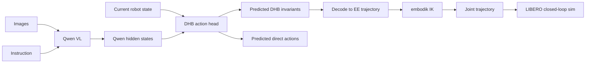
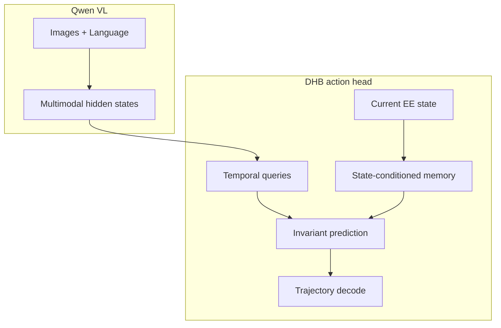

# Qwen + DHB-XR Integration: Internal Note

## Purpose

This note answers two practical questions:

1. How is the Qwen VLM actually used and combined with the DHB-XR action concept in the current codebase?
2. What DHB-related claims are already validated by current results, and what remains unproven?

This is meant as an internal revisit note for later slide writing, manuscript drafting, and onboarding conversations.

## Short Answer

The current StarVLA `QwenDHB` path uses Qwen as the multimodal perception-and-language frontend and DHB-XR as the geometry-aware, state-conditioned action backend.

More concretely:

- Qwen processes images plus language and produces hidden states.
- The DHB action head consumes those hidden states plus current robot state.
- The DHB head predicts continuous DHB invariants and a direct action branch.
- The current best execution path uses the invariant branch:
  - `predict_trajectory()`
  - decode to EE waypoints
  - `embodik` IK
  - JOINT_POSITION execution in sim

So yes, DHB invariants are now genuinely in the real training and rollout pipeline. But the strongest current rollout path is still continuous invariant prediction and decode, not a fully discrete token-only policy execution loop.

## Main Components

The current StarVLA path is assembled from four layers:

1. Qwen VL backbone
2. StarVLA `QwenDHB` framework wrapper
3. DHB action head
4. `embodik` execution adapter

Relevant code paths:

- Qwen VL interface:
  - `vendor/starVLA/starVLA/model/modules/vlm/QWen2_5.py`
- StarVLA framework:
  - `vendor/starVLA/starVLA/model/framework/VLM4A/QwenDHB.py`
- DHB wrapper inside StarVLA:
  - `vendor/starVLA/starVLA/model/modules/action_model/DHBActionHeader.py`
- Local DHB action head:
  - `src/dhb_xr/integration/vla/action_head.py`
- LIBERO to LeRobot export with DHB supervision:
  - `examples/integration/libero_to_lerobot.py`
- LeRobot dataset pass-through:
  - `vendor/starVLA/starVLA/dataloader/gr00t_lerobot/datasets.py`

## High-Level Flow



This is the cleanest mental model for the current system.

## What Qwen Is Doing

Qwen is the multimodal frontend.

In the current code, `QWen2_5.py`:

- builds multimodal Qwen inputs from:
  - one or more images
  - a natural-language instruction
- runs the pretrained Qwen VL model
- returns hidden states from the last layer

So Qwen is responsible for:

- visual scene understanding
- instruction understanding
- multimodal context formation

The important point is that Qwen is not directly responsible for the geometric action contract. It supplies a rich hidden-state representation, and DHB changes how that representation is turned into motion.

## What DHB-XR Is Doing

The DHB action head is the geometry-aware backend.

From `src/dhb_xr/integration/vla/action_head.py`, the head:

- projects Qwen hidden states into a DHB hidden space
- creates learned temporal query embeddings, one query per future timestep
- uses transformer decoding / cross-attention from those queries into the Qwen memory
- optionally prepends projected current robot state into memory
- predicts:
  - `pred_invariants`
  - `pred_actions`

At inference, it can do two things:

1. `predict_action(...)`
   - direct future action chunk

2. `predict(...)` / `predict_trajectory(...)`
   - predict DHB invariants
   - decode them into future SE(3) waypoints using the current pose

This second path is currently the more useful one in embodied evaluation.

## State Conditioning: Where It Enters

The robot state is not primarily injected into Qwen itself.

Instead, the current design is:

- Qwen sees images + language
- DHB head separately receives current state
- DHB decode uses that state to instantiate the motion pattern

That is the central DHB-XR idea in the implemented system.



So a concise way to explain it is:

- Qwen says what should happen.
- DHB says how to realize that motion from the robot's current pose.

## Are We Using DHB Invariants Now?

Yes.

This is now true in the real StarVLA training path, not only in standalone experiments.

The path is:

1. `examples/integration/libero_to_lerobot.py`
   - exports `dhb.linear_invariants`
   - exports `dhb.angular_invariants`

2. `vendor/starVLA/.../datasets.py`
   - passes those fields through into each StarVLA training sample
   - also passes `state` when `include_state: true`

3. `vendor/starVLA/.../QwenDHB.py`
   - extracts `dhb.linear_invariants`
   - extracts `dhb.angular_invariants`
   - concatenates them into the target tensor used to train the DHB invariant branch

So the current training batch really contains:

- image
- language
- state
- action
- DHB invariant supervision

This was not true earlier in the StarVLA setup. It is true now.

## Are We Using DHB Tokens Right Now?

Partly.

The current config `configs/libero_dhbxr_qwen.yaml` enables:

- `use_oat_quantizer: true`

So OAT / tokenization-style compression is part of the current training path.

However, the current execution path does not primarily consume exported discrete token IDs. It uses:

- continuous predicted invariants
- decoded continuous trajectories

So the honest statement is:

- the current model is invariant-aware and tokenizer-regularized
- but embodied execution is still driven by continuous invariant predictions, not a pure discrete token tape

## How This Differs From Regular StarVLA Action Heads

This is easiest to understand by contrast with standard StarVLA frameworks like:

- `QwenOFT`
- `QwenGR00T`

### Regular StarVLA heads

In the standard path:

- Qwen hidden states are used directly for action prediction
- the framework predicts future actions more or less directly
- the action head is the main policy output interface

For example, `QwenOFT` injects action tokens into the Qwen sequence and regresses future actions directly from those action-token hidden states.

### DHB path

In the DHB path:

- Qwen hidden states are treated as multimodal context
- a separate DHB action head predicts a structured motion representation
- current robot state explicitly conditions the decode
- the invariant branch can be decoded into EE trajectories

So the key contrast is:

Regular head:

```text
Qwen hidden states -> future actions
```

DHB head:

```text
Qwen hidden states + current state -> DHB invariants -> decoded motion / actions
```

That is the real architectural difference.

## When It Works, What Is Probably Happening

When a current rollout works, the likely sequence is:

1. Qwen correctly identifies task-relevant scene structure from images and instruction.
2. Qwen hidden states preserve enough semantic and spatial information.
3. The DHB head maps those hidden states into a future motion pattern in invariant space.
4. Current robot state anchors that motion pattern to the actual present arm pose.
5. The decoded trajectory yields plausible EE waypoints.
6. `embodik` converts those waypoints into a better-behaved joint rollout than the direct controller path.
7. The system replans after a short chunk and repeats.

This is why the successful runs feel more geometric and chunked than the direct-action path.

## What Is Already Validated

The strongest currently validated claims are below.

### 1. State conditioning is real and necessary

This is strongly validated.

Regression tests show:

- changing `state` changes the predicted invariants
- the adapter path forwards state and initial pose correctly

Relevant tests:

- `tests/test_action_head.py`
- `tests/test_smolvla_adapter.py`

So we can honestly claim that the current DHB path is state-conditioned in implementation, not only by design.

### 2. DHB invariants are SE(3)-consistent at the representation level

This is the strongest validated DHB-specific claim right now.

The experiment in:

- `_workspace/exp_relative_action_stability.py`
- `_workspace/results_relative_action_stability.json`

shows:

- relative-action tokens change significantly under random SE(3) transforms
- DHB invariant tokens remain effectively unchanged

Current measured summary:

- relative actions: about `18.2%` token change
- DHB invariants: about `0.000%` token change

So the representation-level consistency claim is already well supported.

### 3. The DHB trajectory path is more useful than the direct action path

This is also supported by current diagnostics.

The note:

- `_workspace/starvla_direct_vs_embodik_diagnostic.md`

shows:

- direct `predict_action()` no longer has the old rotation bug
- but it under-moves in translation
- the DHB `predict_trajectory()` path produces a meaningful EE plan

This is why the current best execution path uses:

```text
predict_trajectory() -> embodik -> joints
```

and not direct controller deltas.

### 4. Nonzero offset success exists in the current DHB rollout path

This is now true, but only partially.

We do have real nonzero-offset success videos in the StarVLA + DHB + `embodik` path.

What is not yet true is a single shared robust config above `1/3` at `3 cm`.

So the honest claim is:

- nonzero offset success exists
- robustness is still seed- and phase-dependent

## What Is Not Yet Validated

Several stronger claims are not yet fully supported.

### 1. DHB action head is better than a regular action head in a matched comparison

This is not yet established.

We do have a planned control experiment:

- `_workspace/train_direct_action_head.py`

But there is not yet a completed, matched, apples-to-apples benchmark result showing:

```text
same backbone + same data + same evaluator
regular head vs DHB head
```

So we should not yet claim a clean empirical win over a regular action head.

### 2. Discrete tokenization itself is the main source of embodied improvement

Also not yet established.

The current embodied path is best explained by:

- invariant-conditioned trajectory decoding
- explicit state conditioning
- `embodik` execution

not by a pure discrete token execution story.

So if we talk about “tokens,” we should be careful to distinguish:

- representation-level token stability
- current embodied execution path

### 3. A single shared DHB config robustly generalizes across offsets

Not yet.

Current results still show:

- different seeds prefer different replanning cadence
- the remaining bottleneck is phase logic and trajectory quality

So the current story is promising, not final.

## Best Publicly Safe Claim Right Now

The safest high-value claim is:

> The current StarVLA DHB path trains on explicit DHB invariant targets and current robot state, and its best execution path decodes DHB invariant predictions into EE trajectories executed through `embodik`. Representation-level SE(3) consistency is strongly validated; embodied robustness gains are promising but not yet fully benchmarked against a matched regular-head baseline.

## Not Yet Safe To Claim

These should still be avoided or heavily qualified:

- “DHB action head is already clearly better than regular action heads.”
- “Discrete DHB tokenization alone explains the current rollout gains.”
- “The current StarVLA DHB path is already robust across offsets.”

## Practical Q&A Summary

### Are we using DHB-XR invariants now?

Yes.
They are in the real StarVLA training batch and in the current best rollout path.

### Are we using DHB tokens now?

Partly.
Training uses OAT-style quantization, but embodied rollout still uses continuous predicted invariants and decoded trajectories.

### Does the current system show the consistency claimed in the writeup?

Yes at the representation level, strongly.
Partially at the embodied-control level.

### Can we already validate claims over a regular action head?

Only partially.
We can validate the consistency and structure claims.
We cannot yet claim a full matched baseline win.

## Best Next Validation

The cleanest next validation is one of:

1. Run the matched direct-action control experiment in `_workspace/train_direct_action_head.py`
2. Compare `QwenDHB` against `QwenOFT` or `QwenGR00T` through the same `embodik` evaluation protocol

That would let us move from:

- “the DHB path is structured and promising”

to:

- “the DHB path is empirically better than a matched regular action head”

## Closing Interpretation

The right current mental model is:

- Qwen provides multimodal task understanding.
- DHB-XR changes the action interface into a state-conditioned geometric motion decoder.
- The strongest validated contribution today is representation-level SE(3) consistency.
- The most promising embodied path today is continuous invariant prediction plus `embodik`, not direct raw action rollout.
- The remaining missing piece is a clean controlled benchmark against a regular action head.
