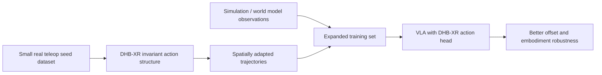
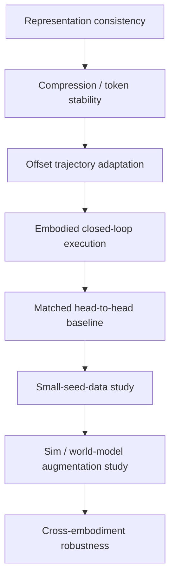

# DHB-XR Scaling Story: Internal Framing Note

## Purpose

This note captures the larger story we may want to tell once the technical
evidence is strong enough.

The goal is not to overclaim today. The goal is to preserve the intended
big-picture narrative now, so we can revisit it later and tighten it as the
results improve.

This note answers:

1. What is the strongest long-term story for DHB-XR?
2. Which parts of that story are already supported?
3. Which parts are still hypotheses that require targeted experiments?
4. How should the technical plan evolve if we want the final paper/project-page
   story to support that narrative?

## The Big-Picture Story

The main story is not only that DHB-XR is a better action representation.

The stronger story is:

- real-world VLA data collection is expensive
- collecting enough spatial diversity directly through teleoperation does not
  scale well
- a small seed dataset collected with teleop + UMI should be expandable
- DHB-XR provides the invariant action structure needed to expand that seed
  dataset across spatial offsets, embodiments, and scene variations
- simulation and world models can provide more diverse observations
- DHB-XR can provide the corresponding spatially adapted trajectories
- a VLA trained with a DHB-XR action head should therefore need less real data
  and generalize more robustly than standard action heads

In short:

> DHB-XR is the geometric interface that makes small real datasets reusable at
> larger scale.

## One-Sentence Thesis

DHB-XR turns a small amount of real robot data into a scalable training
substrate by separating invariant motion structure from viewpoint, offset,
controller, and embodiment-specific execution.

## Problem Setup

The practical bottleneck is not only model capacity. It is data scale.

In realistic VLA pipelines:

- teleoperation is expensive
- UMI-style collection still requires human time and coordination
- many demonstrations are redundant in intent but different in offset,
  viewpoint, or embodiment
- direct action-space learning usually requires collecting much of that
  variation explicitly

The key observation is:

many of the demonstrations we collect are not different tasks. They are the
same task under different spatial conditions.

## The Intended DHB-XR Solution

DHB-XR is meant to separate:

- task-relevant motion structure
from
- nuisance variation in pose, frame choice, and embodiment

That enables a hybrid data strategy:

1. collect a small amount of high-quality real data
2. extract invariant geometric motion structure from that data
3. generate spatially diverse observations using simulation or world models
4. adapt trajectories consistently using DHB-XR
5. train a VLA on the expanded set



## Why This Is Better Than A Standard Action Story

A standard VLA action head usually learns actions directly in one of these
spaces:

- absolute action
- delta action
- relative pose action

These differ in practical usefulness, but all still tie the learned policy
closely to a particular execution convention.

The intended DHB-XR ordering is:

```text
DHB-XR > relative > delta > absolute
```

This should hold because:

- DHB-XR is more invariant than relative pose outputs
- relative pose outputs are more portable than controller-specific deltas
- deltas are usually more stable than fully absolute actions

However, this ordering should be treated carefully:

- it is already plausible at the representation level
- it is not yet fully proven at the end-to-end closed-loop level

## The Clean Story Arc

### 1. Problem

VLA data collection does not scale well if every spatial variation must be
collected directly by human teleoperation.

### 2. Observation

Much of the variation we care about is not new task semantics. It is the same
task under different frames, offsets, embodiments, and scene layouts.

### 3. Key idea

Represent action in an invariant geometric form so one demonstrated behavior
can be adapted across many related situations.

### 4. System

Use a pretrained VLM such as Qwen for scene and task understanding, then use a
DHB-XR action head to predict state-conditioned invariant motion structure.

### 5. Scaling mechanism

Use simulation or world models to generate more diverse observations while
DHB-XR provides corresponding adapted trajectories.

### 6. Payoff

Train with less real data while improving robustness across:

- spatial offsets
- cross-embodiment changes
- scene variations

## What Is Already Supported

These parts of the story are already on reasonably solid ground.

### Representation-level consistency

DHB-XR clearly has the strongest support here.

Current evidence already supports:

- much stronger SE(3) consistency than raw or relative action-like
  representations
- stronger compression and token stability
- a cleaner geometric reuse story than plain direct action prediction

This is currently the strongest part of the whole DHB-XR story.

### State-conditioned geometric decoding

Current StarVLA and SmolVLA work already supports:

- the DHB path really uses `state`
- the invariant decoder is in the real training loop
- the trajectory decode path is more meaningful than the direct action path in
  current embodied tests

### Early embodied plausibility

We can already say:

- the action head works in a real closed loop
- the old orientation bugs were real and have been fixed
- the best current path is not just a tensor-level success, but a real
  `predict_trajectory() -> embodik -> sim` pipeline

## What Is Not Yet Supported Strongly Enough

These parts are still story hypotheses, not strong claims.

### 1. Data-scaling claim

We have not yet shown quantitatively that DHB-XR reduces the amount of real
data needed.

That requires:

- small-seed-data experiments
- controlled augmentation studies
- matched comparisons against regular action heads

### 2. Full ordering claim

We do not yet have the full closed-loop proof that:

```text
DHB-XR > relative > delta > absolute
```

for final task success under matched evaluation.

This is still the intended hypothesis, not yet a final result.

### 3. World-model augmentation claim

We do not yet have the key hybrid result:

- world-model or simulator-generated observation diversity
- plus DHB-XR trajectory adaptation
- plus improved generalization with less real data

This is a central future experiment, not current evidence.

## Safe vs Forward-Looking Claims

### Safe now

- DHB-XR provides a more geometrically consistent representation than standard
  action-like alternatives.
- DHB-XR is well suited for offset adaptation and geometric reuse.
- A Qwen + DHB-XR policy can already use invariant supervision and produce
  executable trajectory predictions.
- The current best DHB-XR execution path is more structured than direct action
  prediction.

### Forward-looking

- DHB-XR will reduce the amount of real teleop data needed at scale.
- DHB-XR will clearly beat regular action heads in final benchmark success.
- DHB-XR plus simulation/world-model augmentation will produce the strongest
  cross-embodiment and cross-offset robustness.

## Evidence Ladder For The Full Story

The final story should be built in this order:

1. representation consistency
2. compression / token stability
3. trajectory adaptation across large offsets
4. embodied closed-loop execution
5. matched action-head comparison
6. small-seed-data scaling study
7. simulator/world-model augmentation study
8. cross-embodiment robustness study

This order matters. The later claims should rest on the earlier ones.



## What The Technical Plan Should Support

If we want the strong final story, the technical plan should not stop at “make
StarVLA work.”

It should explicitly produce evidence for four layers:

### Layer 1: Can DHB-XR work cleanly in closed loop?

This is the current technical focus.

Needed evidence:

- stable canonical StarVLA -> DHB -> `embodik` loop
- shared config across seeds
- nonzero offset success

### Layer 2: Is DHB-XR actually better than a regular action head?

Needed evidence:

- matched `QwenDHB` vs regular-head comparison
- same data, same backbone, same evaluator

### Layer 3: Does DHB-XR help when real data is limited?

Needed evidence:

- train on very small teleop seed sets
- compare learning curves against regular heads
- measure closed-loop success as seed dataset size changes

### Layer 4: Does DHB-XR unlock better augmentation?

Needed evidence:

- spatially diverse observations generated from simulator or world models
- DHB-XR-adapted trajectories paired to those observations
- closed-loop improvements over non-DHB augmentation baselines

## Proposed Story-Driven Experiment Program

### Program A: Matched action-head comparison

Goal:

- test whether DHB-XR beats or matches a regular action head under the same
  execution stack

Minimal comparison:

- `QwenDHB`
- `QwenOFT` or direct action baseline

Outputs:

- success
- IK feasibility
- placement geometry
- videos

### Program B: Small-seed-data study

Goal:

- test whether DHB-XR is more data-efficient

Suggested seed sizes:

- `N = 1`
- `N = 3`
- `N = 5`
- `N = 10`

Outputs:

- success vs data scale
- robustness vs offset
- comparison against regular head

### Program C: Augmentation study

Goal:

- test whether DHB-XR is the right interface for turning a small real dataset
  into a larger synthetic training set

Conditions:

- real-only seed data
- real + simulator observation augmentation
- real + world-model observation augmentation
- each with and without DHB-XR trajectory adaptation

Outputs:

- data-efficiency comparison
- offset generalization comparison
- embodiment transfer comparison if feasible

### Program D: Representation-ordering study

Goal:

- test the intended ordering:
  - `DHB-XR > relative > delta > absolute`

Outputs:

- representation consistency metrics
- compression metrics
- matched embodied success metrics

This program may need to be staged, but it is worth keeping in view because it
would support one of the clearest final claims.

## Recommended Narrative Discipline

For now, the right framing is:

> DHB-XR provides the representation and control foundation for scalable
> low-data VLA training. The current results strongly support the geometric
> consistency argument and partially support the embodied execution argument.
> The full low-data scaling story should be tested through matched baseline and
> augmentation studies next.

This is stronger and more honest than saying:

> we already proved that DHB-XR solves VLA data scaling.

## Practical Next-Step Implication

The current StarVLA technical plan should be expanded, not replaced.

The immediate technical priority remains:

- freeze a canonical StarVLA closed-loop baseline
- improve it until it matches or beats the SmolVLA smoke baseline

But after that, the next plan should explicitly include:

1. matched action-head comparison
2. small-seed-data scaling study
3. simulator / world-model augmentation study

That is the path from a good technical prototype to the stronger final DHB-XR
story.
